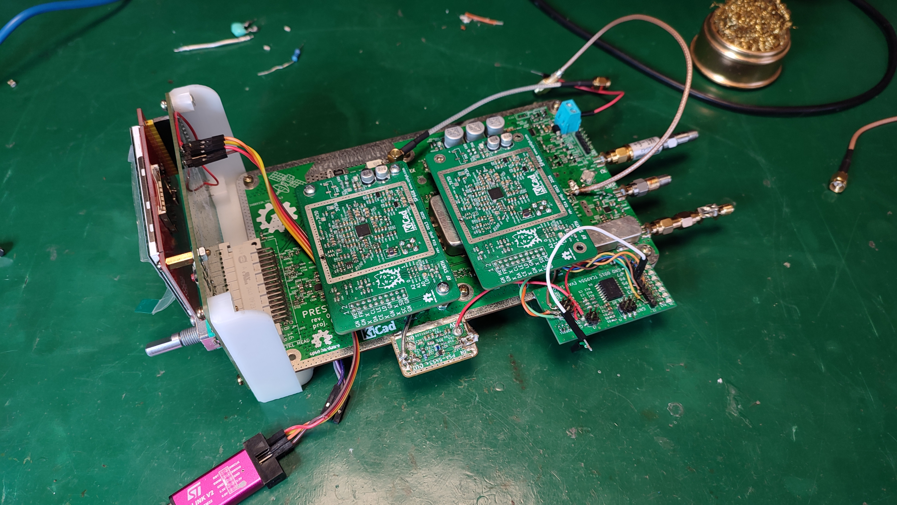
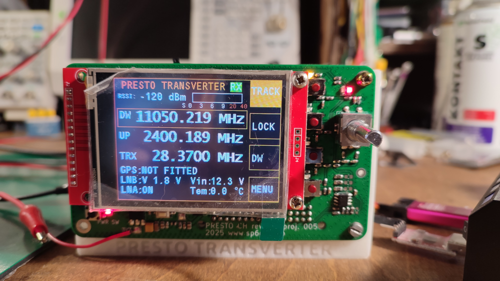
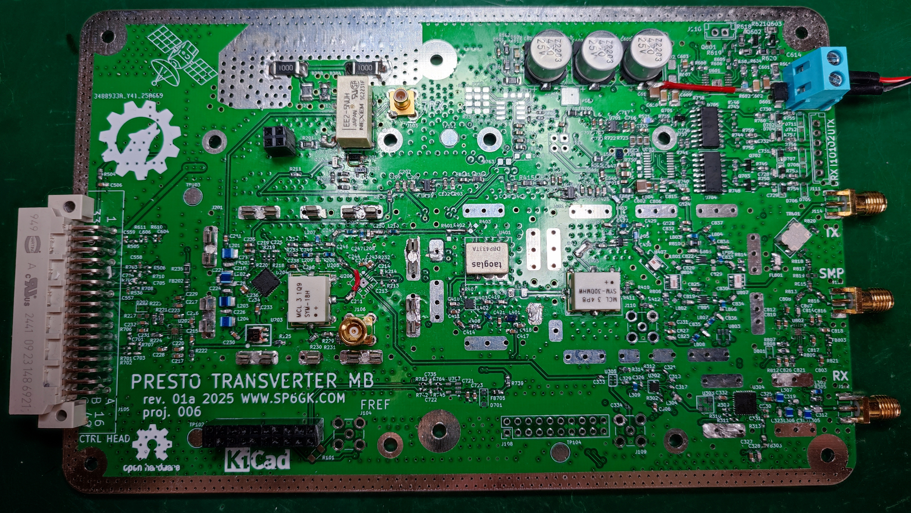

# Presto — QO-100 Transverter

**Status: Work in Progress — October 2026**

Presto is a modular transverter designed to enable communication via the QO-100 satellite using a standard 10 m capable HF transceiver. It provides a 2.4 GHz S-band uplink and downconverts the Ku-band LNB signal for reception on an HF transceiver.

This project includes the schematic and PCB design files, organized under the `ECAD/` directory.
`Documents/` includes interactive BOM and .pdf schematic.

## Features

- **RF signal quality:** Multi-stage frequency conversion, filtering, and high linearity mixers to minimize spurious emissions.
- **Modular hardware:** Replaceable local oscillator modules, a dedicated control head, and extensive RF shielding.
- **LNB front end:** Band pass filtering, attenuation, a bypassable LNA, an integrated downconverter, and an output for an external SDR.
- **LNB control:** Programmable bias-T voltage for polarization selection.
- **Embedded firmware:** STM32F411 microcontroller running C with FreeRTOS.
- **Graphical interface:** Frequency control, configuration menus, and diagnostic information.
- **Remote control:** B.A.S.I.C. (Basic Automated SCPI Interpreter for Controllers) provides serial control through SCPI-like commands.
- **Built-in diagnostics:** Startup and runtime self-tests, error logging, memory integrity checks, and automatic gain control.
- **Calibration tools:** Python scripts and service commands for EEPROM programming and automated calibration.

## System and compatibility
This repository contains all documentation for the motherboard of Presto transverter. Complete system consists also requires:
- **Control Head** Contains mcu with software and HID
- **2 x LO Module** LMX2572 LP based local oscillator module
Repositories for above modules are coming soon

## Project Status

**This project is actively under development and is not yet complete.**
Currently the RF path is under evaluation and characterization. 

